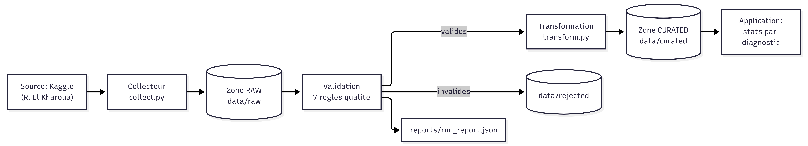
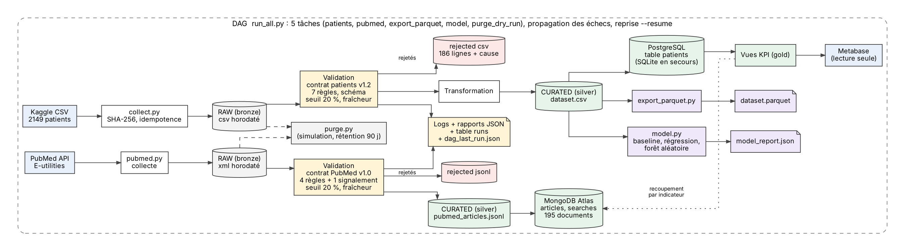

# AlzheimerDataHub : pipeline de collecte et de fiabilisation de données cliniques

Projet final du module **Architectures BD et collecte de données**, ESEO 2026-2027
(prolongement du projet personnel des TP des séances 1 à 3).
Auteure : Wiem Ben M'sahel.

## 1. Objectif de l'application

**Question centrale :** quels indicateurs cliniques (MMSE, tension, cholestérol, âge) distinguent les patients diagnostiqués Alzheimer des autres, dans un jeu de données fiabilisé ?

**Utilisateur :** un chercheur ou data analyst en santé.
**Décision rendue possible :** choisir les indicateurs cliniques à étudier en priorité.
**Fréquence :** ponctuelle (traitement batch lancé à la demande).

### Cas d'usage et KPI

| Cas d'usage | KPI |
|---|---|
| Comparer le MMSE selon le diagnostic | MMSE moyen par diagnostic |
| Cibler la population à étudier | Part de patients diagnostiqués par tranche d'âge |
| Décider si le jeu est exploitable | Taux de lignes rejetées (table `runs`) |

## 2. Sources et conditions d'utilisation

### Source principale : patients (Kaggle)

- Jeu de données : *Alzheimer's Disease Dataset*, par Rabie El Kharoua (Kaggle)
- URL : https://www.kaggle.com/datasets/rabieelkharoua/alzheimers-disease-dataset
- Licence : [Attribution 4.0 International (CC BY 4.0)](https://creativecommons.org/licenses/by/4.0/)
- Date d'accès : 03/11/2026
- Fréquence de mise à jour de la source : jamais (jeu figé)
- Données synthétiques (tag « Synthetic » sur Kaggle) : aucune donnée personnelle de tiers. La colonne `DoctorInCharge` (masquée `XXXConfid`) est exclue de la zone curated.
- Attribution : données de Rabie El Kharoua, licence CC BY 4.0, modifiées par ce projet (sélection de colonnes, renommage, rejet des lignes invalides, variables calculées).

### Seconde source : littérature scientifique (PubMed)

- Source : PubMed, API NCBI E-utilities (`esearch` et `efetch`).
- Documentation : https://www.ncbi.nlm.nih.gov/books/NBK25497/
- Conditions d'usage : politique d'usage des données NCBI (https://www.ncbi.nlm.nih.gov/home/about/policies/). Seules les métadonnées (PMID, titre, revue, année, termes MeSH) sont conservées, pas le texte des résumés (minimisation et droits des éditeurs). Le script limite le débit des requêtes.
- Date d'accès : 06/11/2026
- Contenu : 50 articles récents par indicateur (MMSE, tension, cholestérol, âge) sur la maladie d'Alzheimer, soit 195 articles distincts (5 articles correspondent à deux indicateurs).
- Rôle : situer les quatre indicateurs cliniques dans la littérature. Il n'y a pas de clé commune avec les patients : le recoupement se fait **par indicateur**, pas par patient.
- Stockage : MongoDB Atlas (documents semi-structurés, clé métier `pmid`). Le curated est aussi exporté dans `data/curated/pubmed_articles.jsonl`.

Évaluation détaillée des sources : [docs/source_assessment.md](docs/source_assessment.md)

## 3. Architecture

**Version 1 (cadrage initial) :** une source, un pipeline batch, un curated.



**Version 2 (architecture finale) :** deux sources, deux modèles de stockage (relationnel et document), observabilité.



```
Kaggle CSV -> collect.py -> RAW -> Validation (contrat) -> Transformation -> CURATED (CSV)
                                       |                                        |
                                       +-> REJECTED                             +-> PostgreSQL (table patients)
                                       +-> logs + rapports + table runs                 |
                                                                                        +-> Vues KPI (gold) -> Metabase

PubMed API -> pubmed.py -> RAW (XML) -> Validation -> CURATED (JSONL) -> MongoDB Atlas (articles, searches)
                              |
                              +-> REJECTED (JSONL)
```

**Grain :** une ligne représente un patient (identifié par `PatientID`) avec son bilan clinique et son diagnostic. Côté PubMed, un document représente un article (clé `pmid`).
**Clé métier :** `patient_id` (patients), `pmid` (articles).
**Contrat de données :** [config/data_contract.yaml](config/data_contract.yaml) (version 1.2)
**Dictionnaire de données :** [docs/data_dictionary.md](docs/data_dictionary.md)
**Décision d'architecture :** [docs/ADR_001.md](docs/ADR_001.md)

### Couches

| Couche (nom courant) | Équivalent dans le projet | Rôle |
|---|---|---|
| Bronze (raw) | `data/raw/` | Copie brute horodatée de chaque fichier reçu (CSV avec hash SHA-256, XML PubMed), rejouable |
| Silver (curated) | `data/curated/dataset.csv`, table `patients`, `pubmed_articles.jsonl`, collection `articles` | Données validées, typées, dédoublonnées |
| Gold (mart) | Vues SQL `v_kpi_by_diagnosis` et `v_kpi_by_age_group` | Indicateurs prêts à interroger |

Les lignes invalides sont conservées à part (`data/rejected/`).

### Services (Docker Compose)

| Service | Rôle |
|---|---|
| `postgres` | Base relationnelle (curated, vues KPI, journal des runs) |
| `metabase` | Tableau de bord (lecture des vues KPI et de la table `runs`) |
| `pipeline` | Exécution du pipeline à la demande (`docker compose run`) |

Le pipeline est le seul composant qui écrit dans la base. Metabase ne fait que lire. MongoDB Atlas est un service externe (offre gratuite M0), utilisé uniquement par `pubmed.py`.

**Choix du backend :** si la variable `DATABASE_URL` est définie, le pipeline publie dans PostgreSQL. Sinon, il publie dans SQLite (`data/curated/alzheimer.db`), ce qui permet de lancer le pipeline et les tests sans Docker.

## 4. Prérequis

- Python 3.11 ou supérieur
- Docker Desktop (pour PostgreSQL et Metabase)
- Un compte Kaggle (gratuit) pour télécharger le fichier source
- Optionnel : un cluster MongoDB Atlas gratuit pour la seconde source (voir section 6)

## 5. Installation

```bash
python -m venv .venv
# Activation
.venv\Scripts\activate          # Windows
source .venv/bin/activate       # Linux / macOS
pip install -r requirements.txt
```

Configuration de l'environnement :

```bash
cp .env.example .env            # Windows : Copy-Item .env.example .env
```

Puis éditer `.env` et remplacer `change_me` par un mot de passe de son choix (lettres et chiffres uniquement). Le fichier `.env` n'est pas versionné.

## 6. Exécution

### Démarrage rapide (sans Docker, sans MongoDB)

```bash
# 1. Télécharger alzheimers_disease_data.csv depuis Kaggle
#    et le placer dans data/source_download/
python src/pipeline.py          # collecte, validation, curated, base SQLite, rapport
pytest -q                       # 14 tests
```

Résultat attendu : `PASS_WITH_WARNINGS`, 2149 lignes reçues, 1963 acceptées, 186 rejetées, 1963 patients en base. Le rapport est dans `reports/run_report.json`.

### Mode Docker (PostgreSQL + Metabase)

```bash
docker compose up -d postgres metabase
docker compose build pipeline
docker compose run --rm pipeline
```

Autre fichier source : `docker compose run --rm pipeline --source data/source_download/autre.csv`

Vérifier la base :

```bash
docker compose exec postgres psql -U alzheimer -d alzheimer -c "SELECT * FROM v_kpi_by_diagnosis;"
docker compose exec postgres psql -U alzheimer -d alzheimer -c "SELECT run_id, status, error FROM runs ORDER BY run_id DESC LIMIT 5;"
```

Arrêter : `docker compose down` (conserve les données) ou `docker compose down -v` (supprime aussi les volumes, donc la base et la configuration de Metabase).

### Mode local (SQLite)

```bash
python src/pipeline.py
python src/analysis.py          # tableaux + graphique dans reports/
streamlit run src/app.py        # tableau de bord de secours (lit SQLite)
```

### Seconde source (PubMed et MongoDB Atlas)

Renseigner `MONGODB_URI` et `NCBI_EMAIL` dans `.env` (cluster Atlas gratuit M0, adresse IP autorisée dans Network Access, utilisateur de base avec mot de passe alphanumérique). Sans `MONGODB_URI`, le script produit seulement le JSONL local : le pipeline principal (CSV vers PostgreSQL ou SQLite) ne dépend pas de MongoDB.

```bash
python src/pubmed.py          # collecte, validation, publication
python src/pubmed.py --kpi    # compteurs depuis MongoDB
```

Un échantillon de raw est fourni : `data/raw/sample_pubmed.xml`.

### Tableau de bord Metabase

1. Ouvrir http://localhost:3000 et créer le compte administrateur (local).
2. Ajouter une base PostgreSQL : hôte `postgres`, port `5432`, base, utilisateur et mot de passe de `.env`.
3. Les questions et le tableau de bord ne sont pas versionnés dans Git : voir la capture `docs/dashboard_metabase.png`.

Contenu du tableau de bord : nombre de patients, MMSE moyen par diagnostic, part diagnostiquée par tranche d'âge, journal des exécutions.

### Tests

```bash
pytest -q
```

Les tests tournent sur SQLite, dans un dossier temporaire : ils ne modifient ni le curated, ni le raw, ni la base.

### Démonstration d'une donnée invalide

```bash
python make_dirty.py
python src/pipeline.py --source data/source_download/dirty.csv
```

`make_dirty.py` injecte un MMSE hors plage, un âge impossible et un doublon de `PatientID`. Le rapport obtenu est conservé dans `reports/run_report_dirty_demo.json`. Il faut ensuite relancer le pipeline sur le fichier propre.

### Démonstration de l'alerte de fraîcheur

```powershell
Copy-Item data\source_download\alzheimers_disease_data.csv data\source_download\incident_stale.csv
(Get-Item data\source_download\incident_stale.csv).LastWriteTime = (Get-Date).AddDays(-45)
python src/pipeline.py --source data/source_download/incident_stale.csv
```

Le pipeline journalise un avertissement de fraîcheur et le rapport indique `"freshness": "STALE"` (conservé dans `reports/run_report_stale_demo.json`). Il faut ensuite relancer le pipeline sur le fichier propre.

### Purge selon la rétention

```bash
python src/purge.py             # simulation : liste ce qui serait supprimé
python src/purge.py --apply     # suppression réelle
```

## 7. Arborescence

```
personal-data-collector/
├── README.md
├── requirements.txt             dépendances locales (pipeline, PubMed, tests, Streamlit)
├── requirements-docker.txt      dépendances de l'image du pipeline
├── Dockerfile                   image du pipeline
├── docker-compose.yml           postgres, metabase, pipeline
├── .env.example                 modèle de configuration (sans secret)
├── .gitignore
├── make_dirty.py                données de test invalides
├── make_incidents.py            fichiers d'incident (démonstration manuelle)
├── explore.py                   exploration initiale du CSV
├── config/
│   └── data_contract.yaml       contrat de données v1.2 (colonnes, règles, seuils, fraîcheur, rétention)
├── data/
│   ├── raw/                     copies non modifiées des sources (horodatées)
│   │   ├── sample_source.csv    échantillon de 150 lignes (Kaggle)
│   │   └── sample_pubmed.xml    échantillon de 5 articles (PubMed)
│   ├── curated/
│   │   ├── dataset.csv          patients validés et transformés
│   │   └── pubmed_articles.jsonl    articles validés
│   ├── rejected/
│   │   ├── rejected_rows.csv    patients rejetés avec la cause
│   │   └── pubmed_rejected.jsonl    articles rejetés avec la cause
│   └── source_download/         fichiers téléchargés ou simulés (ignorés par Git)
├── docs/
│   ├── architecture_v1.png      architecture initiale
│   ├── architecture_v2.png      architecture finale
│   ├── ADR_001.md               décision d'architecture
│   ├── data_dictionary.md       dictionnaire de données
│   ├── dashboard_metabase.png   capture du tableau de bord
│   ├── atlas_collections.png    capture MongoDB Atlas
│   ├── incident_test.md         incidents testés et reprise
│   └── source_assessment.md     évaluation des sources
├── reports/
│   ├── run_report.json          dernier rapport d'exécution
│   ├── run_report_dirty_demo.json   rapport de la démo de rejets
│   ├── run_report_stale_demo.json   rapport de la démo de fraîcheur
│   ├── runs/                    un rapport JSON par exécution (CSV et PubMed)
│   ├── profile.json             profilage initial
│   └── mmse_by_diagnosis.png
├── src/
│   ├── contract.py              chargement du contrat YAML
│   ├── collect.py               collecte + copie raw horodatée + hash SHA-256
│   ├── validate.py              profilage + règles du contrat + rejets
│   ├── transform.py             renommage, typage, variables calculées
│   ├── publish.py               publication PostgreSQL ou SQLite (UPSERT), vues KPI, journal des runs
│   ├── pipeline.py              orchestration, idempotence, fraîcheur, rapport, gestion des incidents
│   ├── pubmed.py                seconde source : PubMed vers MongoDB Atlas
│   ├── purge.py                 purge selon la rétention du contrat (simulation par défaut)
│   ├── analysis.py              statistiques par diagnostic
│   └── app.py                   tableau de bord Streamlit (secours, SQLite)
└── tests/
    ├── test_quality.py          règles de qualité
    ├── test_contract.py         le contrat pilote le code
    ├── test_incidents.py        incidents automatisés, idempotence, reprise
    └── test_retention.py        sélection des fichiers à purger
```

## 8. Contrat de données et règles de qualité

Le contrat `config/data_contract.yaml` est la **source de vérité** pour les patients : colonnes attendues (nom source, nom curated, type), règles de qualité, seuil de rejet, fraîcheur et rétention. Le code les lit au lieu de les dupliquer. Un test (`test_changing_contract_changes_behavior`) prouve qu'une modification du contrat change le comportement du pipeline.

### Patients (Kaggle)

| Règle | Dimension | Condition | Action en cas d'échec |
|---|---|---|---|
| `patient_id_present` | Complétude | `PatientID` renseigné | Rejet |
| `age_valid` | Validité | âge entre 0 et 120 | Rejet |
| `mmse_range` | Validité | MMSE entre 0 et 30 | Rejet |
| `diagnosis_domain` | Validité | `Diagnosis` vaut 0 ou 1 | Rejet |
| `bp_coherent` | Cohérence | tension diastolique < systolique | Rejet |
| `cholesterol_plausible` | Validité | cholestérol total entre 100 et 400 | Signalement |
| `duplicate_patient_id` | Unicité | `PatientID` unique | Rejet du doublon et comptage |

Contrôles au niveau du fichier :

- **Fichier vide** : le run échoue (FAIL).
- **Schéma** : colonne attendue manquante ou colonne numérique non numérique, le run échoue (FAIL).
- **Taux de rejet** : au-delà de `thresholds.max_reject_rate` (20 %, défini dans le contrat), la publication est bloquée (FAIL).
- **Fraîcheur** : fichier source plus ancien que `freshness.max_source_age_days` (30 jours), avertissement sans blocage (PASS_WITH_WARNINGS).

Chaque ligne rejetée est conservée dans `data/rejected/rejected_rows.csv` avec la colonne `reject_reason`. Le pipeline ne supprime jamais de lignes silencieusement.

### Articles PubMed

| Règle | Dimension | Condition | Action en cas d'échec |
|---|---|---|---|
| `pmid_present` | Complétude | identifiant PubMed renseigné | Rejet |
| `title_present` | Complétude | titre non vide | Rejet |
| `year_valid` | Validité | année entre 1900 et l'année suivante | Rejet |
| `duplicate_pmid` | Unicité | `pmid` unique | Rejet du doublon et comptage |
| `abstract_present` | Complétude | résumé disponible | Signalement |

Les rejets PubMed sont conservés dans `data/rejected/pubmed_rejected.jsonl`.

## 9. Résultats

### Patients (jeu Kaggle)

| Indicateur | Valeur |
|---|---|
| Lignes en entrée | 2149 |
| Lignes acceptées (curated) | 1963 |
| Lignes rejetées | 186 (8,7 %), toutes par la règle `bp_coherent` |
| Statut qualité | PASS_WITH_WARNINGS |

Les KPI sont interrogeables en SQL (vues `v_kpi_by_diagnosis` et `v_kpi_by_age_group`) et affichés dans Metabase.

| Diagnostic | Patients | MMSE moyen | Tension systolique | Cholestérol total | Âge moyen |
|---|---|---|---|---|---|
| Alzheimer | 694 | 12,0 | 137,1 | 225,7 | 74,9 |
| Non-Alzheimer | 1269 | 16,2 | 137,9 | 224,8 | 74,9 |

| Tranche d'âge | Patients | Diagnostiqués | Part diagnostiquée |
|---|---|---|---|
| < 65 | 314 | 119 | 37,9 % |
| 65-74 | 658 | 218 | 33,1 % |
| 75-84 | 615 | 223 | 36,3 % |
| 85+ | 376 | 134 | 35,6 % |

Sur ce jeu, le MMSE est l'indicateur qui diffère le plus entre les deux groupes. La tension, le cholestérol et l'âge moyens sont quasiment identiques. La part de patients diagnostiqués varie peu selon la tranche d'âge (33 % à 38 %).

Ces résultats concernent un jeu synthétique : ils illustrent le fonctionnement du pipeline et ne constituent pas des conclusions médicales.

### Littérature (PubMed)

Les articles situent les indicateurs dans la littérature. Chiffres au 06/11/2026 (`python src/pubmed.py --kpi`) :

| Indicateur | Articles PubMed (total) | Articles stockés |
|---|---|---|
| MMSE | 6834 | 50 |
| Tension artérielle | 1328 | 50 |
| Cholestérol | 2303 | 50 |
| Âge | 5209 | 50 |

195 articles distincts sont stockés dans MongoDB (un article trouvé par deux indicateurs n'est stocké qu'une fois). Le volume d'articles est un indice de l'intérêt de la recherche pour chaque indicateur, pas une preuve de lien avec nos données.

## 10. Idempotence

- Le fichier source Kaggle est identifié par son hash SHA-256 : un contenu déjà collecté n'est pas recopié dans `data/raw/` (le terminal affiche « Deja collecte »).
- Le curated CSV est mis à jour par UPSERT sur `patient_id`, avec écriture atomique (fichier temporaire puis remplacement).
- La base (PostgreSQL ou SQLite) est mise à jour par UPSERT (`ON CONFLICT (patient_id) DO UPDATE`) dans une transaction unique : tout ou rien. La clé primaire `patient_id` garantit l'unicité.
- Relancer le pipeline avec la même entrée laisse donc `curated_total_rows` et le nombre de patients en base inchangés (1963). Ce comportement est vérifié par `test_rerun_is_idempotent`.
- Côté PubMed, l'UPSERT se fait sur `_id = pmid` : deux exécutions successives laissent 195 documents dans la collection `articles` (vérifié le 06/11/2026).

## 11. Observabilité, incidents et reprise

Chaque exécution reçoit un `run_id` (horodatage UTC) présent dans les logs (`reports/pipeline.log`), dans le rapport `reports/runs/run_<run_id>.json` (ou `pubmed_<run_id>.json`) et, pour les patients, dans la table `runs` de la base.

Le rapport contient : version du contrat, backend de base utilisé, lignes reçues, acceptées et rejetées, doublons, échecs par règle, âge du fichier raw, âge du fichier source (`source_age_days`), fraîcheur (`freshness`), statut (`PASS`, `PASS_WITH_WARNINGS`, `FAIL`) et durée.

### Incidents testés

| Incident | Pipeline | Détection | Résultat |
|---|---|---|---|
| Colonne manquante | patients | `check_schema` | FAIL, code 1 |
| Fichier vide | patients | `check_schema` | FAIL, code 1 |
| 100 % de lignes invalides | patients | seuil de rejet du contrat | FAIL, publication bloquée |
| Source introuvable | patients | `collect` | FAIL, code 1 |
| Publication MongoDB impossible (URI Atlas invalide), incident réel du 06/11/2026 | PubMed | `ConfigurationError` DNS | FAIL, code 1, raw et curated JSONL conservés, reprise après correction de `MONGODB_URI` |

Les quatre premiers sont rejoués par `tests/test_incidents.py`. Dans chaque cas, le pipeline journalise une ligne `INCIDENT`, passe en FAIL, retourne le code de sortie 1, **ne modifie pas le curated** (hash SHA-256 identique avant et après) et **inscrit le FAIL dans la table `runs`**. La reprise consiste à relancer le pipeline sur le fichier valide : le run repasse en PASS_WITH_WARNINGS avec 1963 lignes (`test_recovery_after_incidents`).

Pour l'incident MongoDB, la reprise a donné un run PASS avec 195 articles, puis 195 après une seconde exécution.

Détail et preuves : [docs/incident_test.md](docs/incident_test.md).

### Fraîcheur

Le contrat définit `freshness.max_source_age_days` (30 jours). À chaque run, le pipeline mesure l'âge du fichier source (`source_age_days`) : au-delà du seuil, il journalise un avertissement, le rapport indique `"freshness": "STALE"` et le statut passe en `PASS_WITH_WARNINGS`. Ce n'est pas bloquant : le jeu Kaggle est figé (mise à jour « Never »), l'alerte signale surtout une source qui n'a pas été rafraîchie. Simulation jouée le 06/11/2026 avec un fichier vieilli à 45 jours (rapport : `reports/run_report_stale_demo.json`).

## 12. Gouvernance

- **Responsable du dataset :** Wiem Ben M'sahel (auteure du projet).
- **Rétention :** définie dans le contrat (`retention` : raw 90 jours, rapports 90 jours, au moins les 20 derniers rapports). `python src/purge.py` simule la purge (liste des fichiers à supprimer) et `python src/purge.py --apply` l'exécute. Le raw le plus récent et les échantillons ne sont jamais supprimés. Le curated, la base et MongoDB sont reconstructibles à tout moment depuis le raw.
- **Données personnelles :** aucune (jeu synthétique, colonne `DoctorInCharge` exclue ; PubMed : métadonnées d'articles publiés uniquement).
- **Secrets :** mots de passe et `MONGODB_URI` dans `.env` (non versionné), `.env.example` ne contient que des valeurs fictives.
- **Accès :** le pipeline écrit dans PostgreSQL, Metabase lit seulement (les actions d'écriture de Metabase sont désactivées). Atlas n'accepte que l'adresse IP autorisée.
- **Traçabilité :** chaque ligne de la table `patients` conserve `source_file` et `loaded_run_id` ; chaque article conserve `source_file` et `loaded_run_id`.

## 13. Limites connues

- Jeu patients synthétique : pas de valeur médicale.
- Téléchargement Kaggle manuel (pas d'API automatisée).
- Pas de lien patient-à-patient avec les images IRM, qui ne sont pas intégrées.
- PubMed : seulement 50 articles récents par indicateur, sélectionnés par une requête simple (pas une revue systématique), métadonnées uniquement. Pas de clé commune avec les patients : recoupement par indicateur.
- MongoDB Atlas dépend d'un compte externe : le correcteur doit créer son propre cluster ou se contenter du JSONL local. L'incident MongoDB n'est pas couvert par un test automatisé et `--kpi` affiche une trace brute si Atlas est injoignable.
- Les questions et le tableau de bord Metabase ne sont pas versionnés dans Git (une capture est fournie).
- Metabase et PostgreSQL tournent avec une configuration locale simple, sans chiffrement ni gestion fine des droits.
- Aucune alerte envoyée en cas d'incident : seuls les logs, le code de sortie et la table `runs` le signalent.
- Pas de planification automatique : la collecte et la purge se lancent à la main.
- La fraîcheur mesure l'âge du fichier source ; pour PubMed, aucun contrôle de fraîcheur n'est implémenté.

## 14. Choix et choix écartés

**Retenu**

- **PostgreSQL** pour les données patients : tabulaires, schéma fixe, clé métier, KPI en SQL, accès multi-utilisateur et droits (Metabase en lecture, pipeline en écriture).
- **MongoDB Atlas** pour la littérature PubMed : documents semi-structurés (nombre variable de termes MeSH, champs parfois absents), clé `pmid`, UPSERT idempotent. Rôle limité : situer les KPI dans la littérature, sans jointure patient.
- **SQLite** conservé en secours : lancer les tests et le pipeline sans Docker.
- **Docker Compose** : reproductibilité sur une autre machine en trois commandes.
- **Metabase** : outil de BI réel plutôt qu'une interface codée à la main.

**Écartés**

- **MongoDB pour les données patients** : elles sont tabulaires et à schéma fixe, donc aucun besoin de souplesse documentaire.
- **PostgreSQL pour les articles** : possible avec une colonne JSON, mais moins naturel pour des documents à structure variable.
- **Fichiers CSV seuls** : conservés pour le curated, mais sans contrainte de clé ni requêtes KPI en SQL.
- **Streaming, orchestrateur (Airflow, etc.)** : sources peu volatiles, traitement à la demande.

Comparaison détaillée des options : [docs/ADR_001.md](docs/ADR_001.md).

## 15. Améliorations

### Réalisées pendant le projet final

| Amélioration | Limite traitée |
|---|---|
| Schéma d'entrée, règles et seuil de rejet lus dans le contrat YAML | Contrat et code pouvaient diverger |
| Tests d'incident automatisés dans `pytest` (schéma, fichier vide, 100 % de rejets, source absente) | Incidents joués à la main |
| Message explicite pour un fichier vide | Erreur pandas peu lisible |
| Publication dans PostgreSQL (clé primaire `patient_id`, UPSERT) avec SQLite en secours | Base monoutilisateur, sans droits d'accès |
| Docker et Docker Compose | Reproductibilité sur une autre machine |
| Metabase en lecture seule sur les vues KPI | Interface limitée à un Streamlit minimal |
| Seconde source PubMed (API) vers MongoDB Atlas, avec règles de qualité, rejets et UPSERT | Une seule source tabulaire, sans recoupement avec la littérature |
| Contrôle de fraîcheur de la source et purge selon la rétention, pilotés par le contrat (v1.2), avec test automatisé de la purge | Pas de contrôle de fraîcheur, fichiers qui s'accumulent |

### Restantes

| Amélioration | Limite traitée |
|---|---|
| Modèle de classification du diagnostic sur la couche silver (démonstration seulement : données synthétiques) | Exploitation des données au-delà des KPI |
| Télécharger la source via l'API Kaggle (jeton en variable d'environnement) | Téléchargement manuel |
| Automatiser l'exécution (GitHub Actions + `pytest`) | Pas de planification ni de contrôle automatique |
| Tests automatisés de `pubmed.py` (parsing et validation sur un XML d'exemple) | Seconde source non couverte par pytest |
| Alerter en cas d'échec (e-mail ou webhook) | Seuls les logs signalent un incident |
| Exposer les KPI par une API (FastAPI) | Usage limité au tableau de bord |
| Exporter le curated en Parquet | Échanges avec d'autres outils d'analyse |
| Orchestrer avec un DAG (Airflow ou Prefect) | Plusieurs sources et dépendances entre tâches |
| Historiser les modifications de la base | Source qui évolue dans le temps |
| Outil de qualité dédié (Great Expectations, Pandera) | Nombre de règles difficile à maintenir à la main |
| Intégrer les images IRM avec un stockage objet | Disponibilité d'une source avec lien patient-à-patient |

## 16. Usage d'outils d'IA

- **Outil utilisé :** Claude (Anthropic).
- **Tâches assistées :** structuration du projet, squelettes de code (`publish.py`, `app.py`, `pubmed.py`, `purge.py`, `make_incidents.py`), migration du contrat YAML, tests d'incident et de rétention, configuration Docker Compose, Metabase et MongoDB Atlas, ADR, schémas d'architecture, relecture de la documentation.
- **Vérifications réalisées :** exécution du pipeline et des 14 tests, contrôle des KPI dans PostgreSQL contre `analysis.py`, test des quatre incidents avec code de sortie et comparaison du hash du curated avant et après, relance du pipeline pour vérifier l'idempotence (1963 lignes en base), diagnostic et correction de l'erreur DNS de l'URI Atlas, exécution de `pubmed.py` deux fois (195 documents à chaque fois), simulation de fraîcheur (fichier vieilli à 45 jours) et purge en simulation, contrôle que `.env` n'est pas versionné.
- **Parties retravaillées personnellement :** [À COMPLÉTER PAR TOI : 3 ou 4 phrases vraies, voir les questions dans le message]