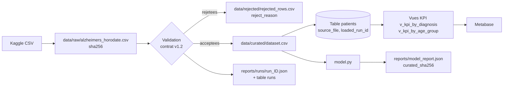
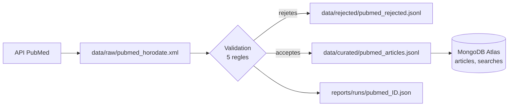

# Lineage : de la source à l'indicateur

## Flux patients



## Flux PubMed



## Identifiants conservés à chaque étape

| Étape | Sortie | Identifiants qui permettent de remonter à la source |
|---|---|---|
| Collecte | copie raw horodatée | horodatage dans le nom, hash SHA-256 |
| Validation | rejets | `reject_reason` (règle en cause) |
| Publication | table `patients`, collection `articles` | `source_file` (fichier raw d'origine), `loaded_run_id` |
| Exécution | rapport JSON, table `runs` | `run_id` |
| Modèle | `model_report.json` | `curated_sha256` (hash du curated lu) |

## Remonter d'un KPI à sa source

```sql
SELECT DISTINCT source_file, loaded_run_id FROM patients;
```

Le résultat donne le fichier raw d'origine (`data/raw/<source_file>`) et le rapport du run qui l'a chargé (`reports/runs/run_<loaded_run_id>.json`).