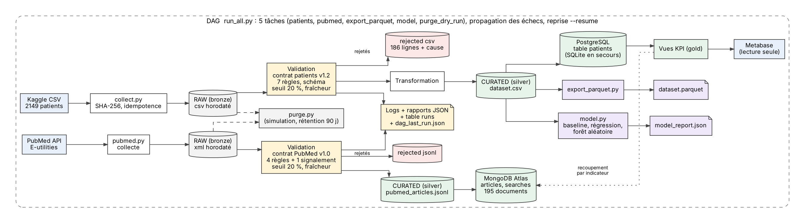
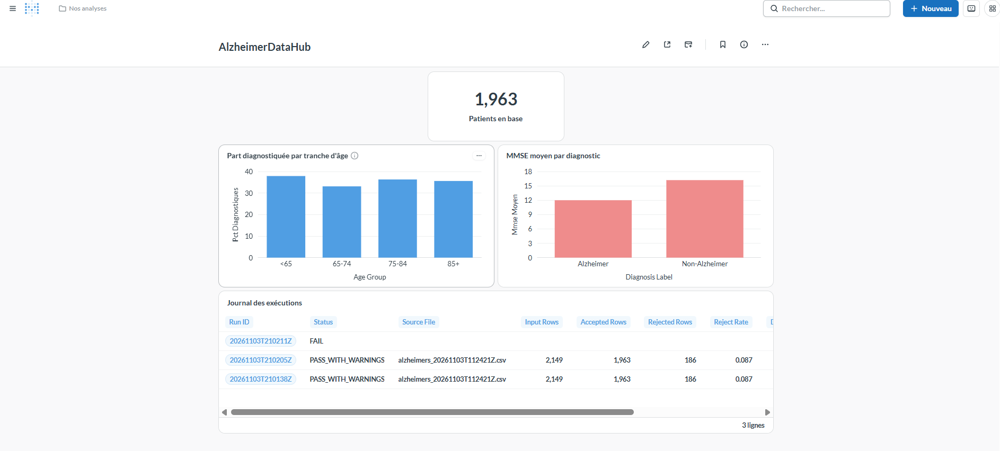
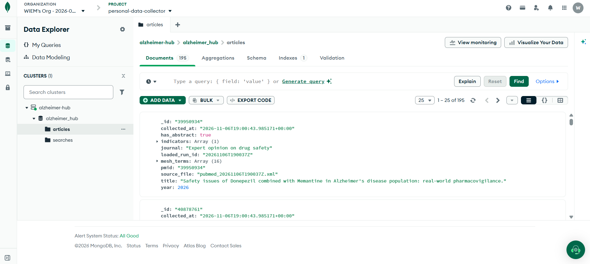

# AlzheimerDataHub : collecte, fiabilisation et exploitation de données sur la maladie d'Alzheimer

**Synthèse du projet final**, module Architectures BD et collecte de données, ESEO 2026-2027
**Auteure :** Wiem Ben M'sahel, 08/11/2026
**Dépôt :** https://github.com/WiemBenMsahel/personal-data-collector

## 1. Problème, utilisateur, indicateurs et sources

**Problème.** Les données cliniques brutes sont rarement prêtes à l'emploi : valeurs impossibles, doublons, schéma qui change. Un chercheur ou data analyst en santé ne peut pas s'appuyer dessus sans contrôle.

**Question centrale.** Quels indicateurs cliniques (MMSE, tension, cholestérol, âge) distinguent les patients diagnostiqués Alzheimer des autres, dans un jeu de données fiabilisé ?

**Utilisateur et décision.** Un chercheur ou data analyst en santé qui doit choisir les indicateurs à étudier en priorité. Traitement ponctuel (batch à la demande), car la source est figée.

**Indicateurs (KPI).**

| Cas d'usage | KPI |
|---|---|
| Comparer le MMSE selon le diagnostic | MMSE moyen par diagnostic |
| Cibler la population à étudier | Part de patients diagnostiqués par tranche d'âge |
| Décider si le jeu est exploitable | Taux de lignes rejetées |

**Sources.**

| Source | Rôle | Format | Licence / conditions | Accès |
|---|---|---|---|---|
| Kaggle, *Alzheimer's Disease Dataset* (R. El Kharoua) | Patients (principale) | CSV, 2149 lignes, 35 colonnes | CC BY 4.0, jeu synthétique | Téléchargement manuel, 03/11/2026 |
| PubMed (API NCBI E-utilities) | Littérature (seconde) | XML, 195 articles | Politique d'usage du NCBI, métadonnées seulement | API publique, 06/11/2026 |
| OASIS (imagerie) | Écartée | NIfTI / JPEG | Accord d'utilisation | Accès sur demande, volumes hors proportion |

Il n'existe aucune clé commune entre les patients et les articles : le recoupement se fait **par indicateur**, pas par patient.

**Conformité.** Jeu patients synthétique, aucune donnée personnelle de tiers. Minimisation : 11 colonnes conservées sur 35 dans le curated, colonne `DoctorInCharge` (masquée) exclue. Pour PubMed, seules les métadonnées sont stockées. Aucun secret dans le dépôt (URI MongoDB dans `.env`, non versionné).

## 2. Pipeline et architecture

**Chaîne patients.** Collecte reproductible, zone raw horodatée avec hash SHA-256, validation pilotée par le contrat de données, rejets conservés, transformation, zone curated (CSV), base PostgreSQL (SQLite en secours) par UPSERT, vues SQL d'indicateurs, tableau de bord Metabase.

**Chaîne PubMed.** Recherche par indicateur, raw XML horodaté, validation, curated JSONL, MongoDB Atlas (UPSERT sur `pmid`).

**Grain et clés.** Une ligne = un patient (clé `patient_id`) ; un document = un article (clé `pmid`).

| Couche | Équivalent dans le projet |
|---|---|
| Bronze (raw) | `data/raw/` : copies non modifiées, rejouables |
| Silver (curated) | `dataset.csv`, table `patients`, `pubmed_articles.jsonl`, collection `articles` |
| Gold (mart) | Vues SQL `v_kpi_by_diagnosis` et `v_kpi_by_age_group` |

**Contrat de données (version 1.2).** Le fichier `config/data_contract.yaml` est la source de vérité : colonnes, règles de qualité, seuil de rejet (20 %), fraîcheur (30 jours), rétention (90 jours). Le code le lit ; un test prouve que modifier le contrat change le comportement.

**Orchestration.** Un pipeline Python à étapes séparées (collecte, validation, transformation, publication), lancé à la demande, avec rapports et logs. Un orchestrateur (Airflow) n'est pas justifié : une source figée, un traitement ponctuel. Docker Compose fournit PostgreSQL et Metabase.

## 3. Qualité, incidents et observabilité

**Règles de qualité.** Patients : 7 règles (complétude, validité, cohérence, unicité), dont `bp_coherent` (tension diastolique inférieure à la systolique) qui a rejeté 186 lignes. Articles : 4 règles de rejet et 1 signalement. Les lignes rejetées sont conservées avec la cause (`reject_reason`), jamais supprimées en silence.

**Contrôles au niveau du fichier.** Fichier vide, schéma (colonne manquante), seuil de rejet (publication bloquée au-delà de 20 %), fraîcheur (avertissement au-delà de 30 jours).

**Incidents testés.**

| Incident | Détection | Résultat |
|---|---|---|
| Colonne manquante | contrôle du schéma | FAIL, code 1 |
| Fichier vide | contrôle du schéma | FAIL, code 1 |
| 100 % de lignes invalides | seuil de rejet | FAIL, publication bloquée |
| Source introuvable | collecte | FAIL, code 1 |
| MongoDB injoignable (incident réel, 06/11) | erreur DNS | FAIL ; raw et curated conservés ; reprise après correction |
| Source trop ancienne (simulée, 45 jours) | fraîcheur | avertissement, statut PASS_WITH_WARNINGS |

Dans les cas bloquants, le curated n'est pas modifié (hash SHA-256 identique avant et après) et l'échec est inscrit dans la table `runs`. Reprise : relancer le pipeline sur le fichier valide.

**Observabilité.** Chaque exécution reçoit un `run_id` présent dans les logs, dans un rapport JSON (`reports/runs/`) et dans la table `runs`. Le rapport contient volumes, taux de rejet, échecs par règle, âge de la source, fraîcheur, statut et durée.

**Idempotence.** Relancer le pipeline ne duplique rien : 1963 patients en base après plusieurs exécutions, 195 articles dans MongoDB après plusieurs exécutions.

**Tests et reproductibilité.** 14 tests automatisés. Rejeu sur un clone propre du dépôt le 07/11/2026 : pipeline, tests et seconde source (sans MongoDB) fonctionnent en suivant le README.

## 4. Résultat

**Qualité de la source.** 2149 lignes reçues, 1963 acceptées, 186 rejetées (8,7 %), toutes par la règle de cohérence de la tension.

| Diagnostic | Patients | MMSE moyen | Tension systolique | Cholestérol total | Âge moyen |
|---|---|---|---|---|---|
| Alzheimer | 694 | 12,0 | 137,1 | 225,7 | 74,9 |
| Non-Alzheimer | 1269 | 16,2 | 137,9 | 224,8 | 74,9 |

| Tranche d'âge | Patients | Part diagnostiquée |
|---|---|---|
| < 65 | 314 | 37,9 % |
| 65-74 | 658 | 33,1 % |
| 75-84 | 615 | 36,3 % |
| 85+ | 376 | 35,6 % |

**Lecture.** Sur ce jeu, le MMSE est l'indicateur qui diffère le plus entre les deux groupes (12,0 contre 16,2). La tension, le cholestérol et l'âge moyen sont quasiment identiques, et la part de patients diagnostiqués varie peu selon la tranche d'âge (33 % à 38 %). Le jeu étant synthétique, ces résultats illustrent le pipeline et ne constituent pas des conclusions médicales.

**Littérature (PubMed, 06/11/2026).**

| Indicateur | Articles PubMed (total) | Articles stockés |
|---|---|---|
| MMSE | 6834 | 50 |
| Tension artérielle | 1328 | 50 |
| Cholestérol | 2303 | 50 |
| Âge | 5209 | 50 |

195 articles distincts sont stockés (5 articles correspondent à deux indicateurs). Le volume d'articles indique l'intérêt de la recherche pour chaque indicateur ; ce n'est pas une preuve de lien avec nos données.

**Consultation.** Tableau de bord Metabase (http://localhost:3000, lecture des vues KPI et de la table `runs`), requêtes SQL sur les vues, tableau de bord Streamlit de secours.

## 5. Décisions, limites et perspectives

**Décision d'architecture (ADR 001).** Quatre options comparées : fichiers seuls, PostgreSQL seul (articles en JSONB), PostgreSQL + MongoDB Atlas, MongoDB seul. Option retenue : PostgreSQL pour les patients (données tabulaires, schéma fixe, clé primaire, vues KPI) et MongoDB Atlas pour les articles (documents semi-structurés, clé `pmid`). Architecture batch, raw en fichiers.

**Compromis assumés.** Deux systèmes de stockage pour de petits volumes. PostgreSQL avec une colonne JSONB aurait suffi techniquement pour 195 articles ; MongoDB a été retenu sur la recommandation de l'enseignant, avec un rôle volontairement limité. Condition de réexamen : revenir à PostgreSQL seul si la littérature reste de quelques centaines d'articles sans besoin de recherche textuelle.

**Gouvernance.** Responsable : l'auteure. Rétention : raw et rapports 90 jours (purge simulée par défaut). Aucune donnée personnelle. Traçabilité : `source_file` et `loaded_run_id` conservés sur chaque ligne ou document.

**Limites.**

- Jeu synthétique : pas de valeur médicale.
- Téléchargement Kaggle manuel.
- Le fichier des rejets conserve la ligne source complète (acceptable en synthétique, à filtrer sur des données réelles).
- PubMed : 50 articles récents par indicateur, requête simple, pas de revue systématique ; pas de clé commune avec les patients.
- MongoDB Atlas dépend d'un compte externe (mode dégradé : JSONL local).
- Aucune alerte envoyée, pas de planification automatique, fraîcheur non contrôlée pour PubMed.

**Perspectives.** Téléchargement par l'API Kaggle, exécution automatisée (GitHub Actions + tests), tests automatisés de la seconde source, alertes en cas d'échec, modèle de classification du diagnostic, export Parquet, intégration d'images IRM avec stockage objet.

**Usage d'outils d'IA.** Claude (Anthropic) a assisté la structuration, des squelettes de code, la documentation et la relecture ; le code a été exécuté, testé et vérifié (voir la section 16 du README pour le détail et les parties retravaillées personnellement).