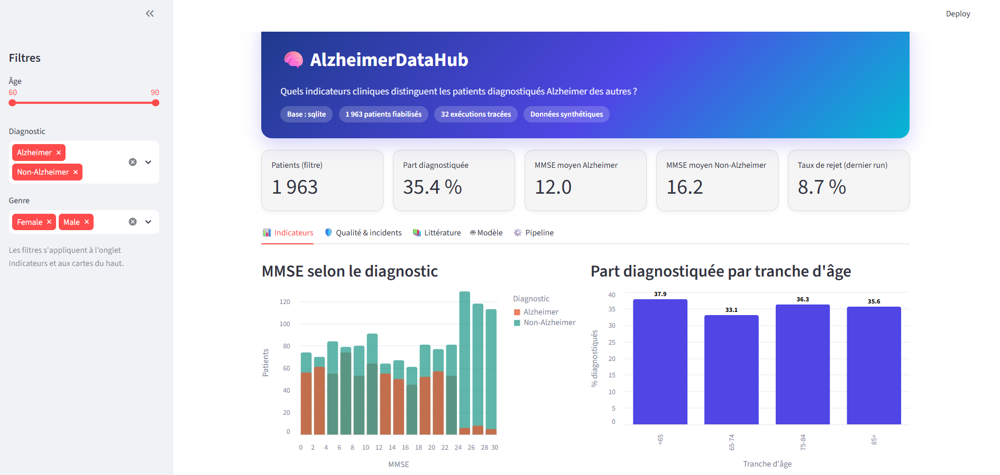

# AlzheimerDataHub : collecte, fiabilisation et exploitation de données sur la maladie d'Alzheimer

**Synthèse du projet final**, module Architectures BD et collecte de données, ESEO 2026-2027
**Auteure :** Wiem Ben M'sahel, 08/11/2026
**Dépôt Git (public) :** [https://github.com/WiemBenMsahel/personal-data-collector](https://github.com/WiemBenMsahel/personal-data-collector)

## 1. Problème, utilisateur, indicateurs et sources

**Problème.** Les données cliniques brutes sont rarement prêtes à l'emploi : valeurs impossibles, doublons, schéma qui change. Un chercheur ou data analyst en santé ne peut pas s'appuyer dessus sans contrôle.

**Question centrale.** Quels indicateurs cliniques (MMSE, tension, cholestérol, âge) distinguent les patients diagnostiqués Alzheimer des autres, dans un jeu de données fiabilisé ?

**Utilisateur et décision.** Un chercheur ou data analyst en santé qui doit choisir les indicateurs à étudier en priorité. Traitement ponctuel (batch à la demande), car la source est figée.

**Indicateurs (KPI).**

| Cas d'usage | KPI |
|---|---|
| Comparer le MMSE selon le diagnostic | MMSE moyen par diagnostic |
| Cibler la population à étudier | Part de patients diagnostiqués par tranche d'âge |
| Décider si le jeu est exploitable | Taux de lignes rejetées |

**Sources.**

| Source | Rôle | Format | Licence / conditions | Accès |
|---|---|---|---|---|
| Kaggle, *Alzheimer's Disease Dataset* (R. El Kharoua) | Patients (principale) | CSV, 2149 lignes, 35 colonnes | CC BY 4.0, jeu synthétique | Téléchargement manuel, 03/11/2026 |
| PubMed (API NCBI E-utilities) | Littérature (seconde) | XML, 195 articles | Politique d'usage du NCBI, métadonnées seulement | API publique, 06/11/2026 |
| OASIS (imagerie) | Écartée | NIfTI / JPEG | Accord d'utilisation | Accès sur demande, volumes hors proportion |

Il n'existe aucune clé commune entre les patients et les articles : le recoupement se fait **par indicateur**, pas par patient.

**Conformité.** Jeu patients synthétique, aucune donnée personnelle de tiers. Minimisation : 11 colonnes conservées sur 35 dans le curated, colonne `DoctorInCharge` (masquée) exclue. Pour PubMed, seules les métadonnées sont stockées. Aucun secret dans le dépôt (URI MongoDB dans `.env`, non versionné).

## 2. Pipeline et architecture

**Chaîne patients.** Collecte reproductible, zone raw horodatée avec hash SHA-256, validation pilotée par le contrat de données, rejets conservés, transformation, zone curated (CSV), base PostgreSQL (SQLite en secours) par UPSERT, vues SQL d'indicateurs, tableaux de bord Metabase et Streamlit. Un modèle de classification et un export Parquet lisent la couche curated.

**Chaîne PubMed.** Recherche par indicateur (requêtes définies dans un contrat), raw XML horodaté, validation, curated JSONL, MongoDB Atlas (UPSERT sur `pmid`).

**Grain et clés.** Une ligne = un patient (clé `patient_id`) ; un document = un article (clé `pmid`).

| Couche | Équivalent dans le projet |
|---|---|
| Bronze (raw) | `data/raw/` : copies non modifiées, rejouables |
| Silver (curated) | `dataset.csv`, table `patients`, `pubmed_articles.jsonl`, collection `articles` |
| Gold (mart) | Vues SQL `v_kpi_by_diagnosis` et `v_kpi_by_age_group` |

**Contrats de données.** `config/data_contract.yaml` (patients, version 1.2) et `config/pubmed_contract.yaml` (PubMed, version 1.0) sont les sources de vérité : colonnes, règles de qualité, seuils de rejet (20 %), fraîcheur, rétention. Le code les lit ; des tests prouvent que modifier un contrat change le comportement.

**Orchestration.** Un DAG minimal en Python (`src/run_all.py`, bibliothèque standard) enchaîne 5 tâches : `patients` et `pubmed` (indépendantes), puis `export_parquet`, `model` et `purge_dry_run`. Une tâche ne démarre que si ses dépendances ont réussi ; en cas d'échec, ses descendantes sont marquées `UPSTREAM_FAILED` et les tâches indépendantes continuent. L'option `--resume` rejoue seulement ce qui n'avait pas réussi. Airflow n'est pas justifié : une machine, 5 tâches, aucune planification. Docker Compose fournit PostgreSQL et Metabase.

**Extensions de démonstration (hors chaîne principale).** Une API REST en lecture seule (FastAPI) et une simulation de flux (contrôle qualité en continu avec fenêtre glissante). Elles ne sont pas nécessaires au projet : les sources sont figées et aucun consommateur autre que le tableau de bord n'existe. Elles sont isolées du pipeline, testées, et la décision d'architecture reste le batch.

## 3. Qualité, incidents et observabilité

**Règles de qualité.** Patients : 7 règles (complétude, validité, cohérence, unicité), dont `bp_coherent` (tension diastolique inférieure à la systolique) qui a rejeté 186 lignes. Articles : 4 règles de rejet et 1 signalement. Les lignes rejetées sont conservées avec la cause (`reject_reason`), jamais supprimées en silence.

**Contrôles au niveau du fichier ou du lot.** Fichier vide, schéma (colonne manquante), seuil de rejet défini dans chaque contrat (publication bloquée au-delà de 20 %), fraîcheur (patients : avertissement au-delà de 30 jours ; PubMed : avertissement si l'article le plus récent a plus d'un an).

**Incidents testés.**

| Incident | Détection | Résultat |
|---|---|---|
| Colonne manquante | contrôle du schéma | FAIL, code 1 |
| Fichier vide | contrôle du schéma | FAIL, code 1 |
| 100 % de lignes invalides | seuil de rejet | FAIL, publication bloquée |
| Source introuvable | collecte | FAIL, code 1 |
| 100 % d'articles invalides (PubMed) | seuil de rejet PubMed | FAIL ; raw et rejets conservés ; curated non écrit |
| Panne de la source patients pendant le DAG | code de sortie de la tâche | `patients` en échec, 3 tâches `UPSTREAM_FAILED`, `pubmed` réussit ; reprise avec `--resume` |
| MongoDB injoignable (incident réel, 06/11) | erreur DNS | FAIL ; raw et curated conservés ; reprise après correction |
| Source trop ancienne (simulée, 45 jours) | fraîcheur | avertissement, statut PASS_WITH_WARNINGS |
| Dérive dans le flux (MMSE impossible sur 200 événements) | fenêtre glissante, seuil 20 % | alerte, puis retour à la normale |

Dans les cas bloquants, le curated n'est pas modifié (hash SHA-256 identique avant et après) et, pour les patients, l'échec est inscrit dans la table `runs`. Reprise : relancer le pipeline sur le fichier valide ou `run_all.py --resume`.

**Observabilité.** Chaque exécution reçoit un `run_id` présent dans les logs, dans un rapport JSON (`reports/runs/`) et, pour les patients, dans la table `runs`. Le rapport contient volumes, taux de rejet, échecs par règle, âge de la source, fraîcheur, statut et durée. Le DAG conserve l'état de chaque tâche (`reports/dag_last_run.json`, preuve de panne dans `reports/dag_demo_failure.json`).

**Idempotence.** Relancer le pipeline ne duplique rien : 1963 patients en base après plusieurs exécutions, 195 articles dans MongoDB après plusieurs exécutions.

**Tests et reproductibilité.** 41 tests automatisés (règles de qualité, contrat, incidents, rétention, PubMed, modèle, DAG, export Parquet, API, flux). Rejeu complet sur un clone propre du dépôt avant la remise : pipeline, tests, seconde source (sans MongoDB) et modèle fonctionnent en suivant le README.

## 4. Résultat

*Tableau de bord Streamlit (onglet Indicateurs) : 1 963 patients fiabilisés, MMSE moyen de 12,0 pour Alzheimer contre 16,2, 8,7 % de lignes rejetées lors du dernier run. Cinq onglets : indicateurs, qualité et incidents, littérature, modèle, pipeline.*

**Qualité de la source.** 2149 lignes reçues, 1963 acceptées, 186 rejetées (8,7 %), toutes par la règle de cohérence de la tension.

| Diagnostic | Patients | MMSE moyen | Tension systolique | Cholestérol total | Âge moyen |
|---|---|---|---|---|---|
| Alzheimer | 694 | 12,0 | 137,1 | 225,7 | 74,9 |
| Non-Alzheimer | 1269 | 16,2 | 137,9 | 224,8 | 74,9 |

| Tranche d'âge | Patients | Part diagnostiquée |
|---|---|---|
| < 65 | 314 | 37,9 % |
| 65-74 | 658 | 33,1 % |
| 75-84 | 615 | 36,3 % |
| 85+ | 376 | 35,6 % |

**Lecture.** Sur ce jeu, le MMSE est l'indicateur qui diffère le plus entre les deux groupes (12,0 contre 16,2). La tension, le cholestérol et l'âge moyen sont quasiment identiques, et la part de patients diagnostiqués varie peu selon la tranche d'âge (33 % à 38 %). Le jeu étant synthétique, ces résultats illustrent le pipeline et ne constituent pas des conclusions médicales.

**Littérature (PubMed, 07/11/2026).**

| Indicateur | Articles PubMed (total) | Articles stockés |
|---|---|---|
| MMSE | 6834 | 50 |
| Tension artérielle | 1328 | 50 |
| Cholestérol | 2303 | 50 |
| Âge | 5209 | 50 |

195 articles distincts sont stockés (5 articles correspondent à deux indicateurs). Le volume d'articles indique l'intérêt de la recherche pour chaque indicateur ; ce n'est pas une preuve de lien avec nos données.

**Usage de la couche silver : modèle de classification.** Deux modèles (régression logistique, forêt aléatoire) estiment le diagnostic à partir des 9 indicateurs cliniques du curated. Ils sont comparés à une baseline qui prédit toujours la classe majoritaire, évalués par validation croisée à 5 plis puis sur un jeu de test de 393 lignes. La graine est fixée (42) et le rapport conserve le hash du curated lu.

| Modèle | AUC (validation croisée) | AUC (test) | Rappel |
|---|---|---|---|
| Baseline majoritaire | 0,500 | 0,500 | 0,00 |
| Régression logistique | 0,711 | 0,722 | 0,60 |
| Forêt aléatoire | 0,715 | 0,757 | 0,48 |

Le signal est réel mais modeste, et les deux modèles sont à égalité en validation croisée. L'accuracy est trompeuse (la baseline atteint 0,646 sans détecter aucun patient) : on retient l'AUC et le rappel. Par importance par permutation, le MMSE (baisse d'AUC de 0,16) et les plaintes de mémoire (0,11) portent presque tout le signal ; la tension, le cholestérol et l'âge n'apportent presque rien, ce qui confirme les KPI. Le MMSE servant déjà à poser le diagnostic en pratique, son poids reflète surtout la génération des données. Données synthétiques : aucune valeur médicale.

**Simulation de flux (extension).** Le fichier est rejoué comme un flux d'événements, chacun contrôlé à l'arrivée. Sans dérive, le flux retrouve les volumes du batch (2149 événements, 1963 acceptés, 186 rejetés), ce qui prouve la cohérence des deux logiques. Avec une dérive injectée (200 événements corrompus), une alerte part peu après l'événement 600 puis le retour à la normale est signalé : le batch, lui, ne détecterait la panne qu'à la fin du fichier.

**Consultation.** Tableaux de bord Metabase (http://localhost:3000, vues KPI et table `runs`) et Streamlit (`streamlit run src/app2.py`), API en lecture seule (http://localhost:8000/docs), requêtes SQL sur les vues, rapport du modèle (`reports/model_report.json`), export Parquet.

## 5. Décisions, limites et perspectives

**Décision d'architecture (ADR 001).** Options comparées : fichiers seuls, PostgreSQL seul (articles en JSONB), PostgreSQL + MongoDB Atlas, MongoDB seul. Option retenue : PostgreSQL pour les patients (données tabulaires, schéma fixe, clé primaire, vues KPI) et MongoDB Atlas pour les articles (documents semi-structurés, clé `pmid`). Architecture batch, raw en fichiers, DAG minimal en Python plutôt qu'Airflow. L'API et la simulation de flux sont des extensions assumées comme non nécessaires. Pour le modèle, des algorithmes simples et interprétables suffisent à une démonstration sur 1963 lignes.

**Compromis assumés.** Deux systèmes de stockage pour de petits volumes : PostgreSQL avec une colonne JSONB aurait suffi techniquement pour 195 articles, MongoDB a été retenu sur la recommandation de l'enseignant avec un rôle limité (réexamen : revenir à PostgreSQL seul si la littérature reste de quelques centaines d'articles). Le DAG n'a ni interface ni planification (réexamen : Airflow ou Prefect si les sources deviennent périodiques). L'API n'a pas d'authentification (réexamen : avant toute exposition hors de la machine locale).

**Choix écartés.** Streaming comme mode de traitement principal (sources peu volatiles), images IRM (pas de lien patient-à-patient), modèles complexes (aucun besoin démontré).

**Gouvernance.** Responsable : l'auteure. Rétention : raw et rapports 90 jours (purge simulée par défaut). Aucune donnée personnelle. Traçabilité : `source_file` et `loaded_run_id` conservés sur chaque ligne ou document, lignage décrit dans `docs/lineage.md`.

**Limites.**

- Jeu synthétique : pas de valeur médicale.
- Téléchargement Kaggle manuel.
- Le fichier des rejets conserve la ligne source complète (acceptable en synthétique, à filtrer sur des données réelles).
- PubMed : 50 articles récents par indicateur, requête simple, pas de revue systématique ; pas de clé commune avec les patients ; seuil de fraîcheur simple.
- MongoDB Atlas dépend d'un compte externe (mode dégradé : JSONL local) ; l'incident MongoDB n'est pas couvert par un test automatisé.
- Modèle : démonstration seulement (9 indicateurs, un seul découpage train/test, pas de réglage des hyperparamètres).
- API sans authentification, flux simulé à partir d'une source figée.
- Aucune alerte envoyée, pas de planification automatique.

**Perspectives.** Téléchargement par l'API Kaggle, exécution automatisée (GitHub Actions + tests), alertes en cas d'échec, test automatisé de l'incident MongoDB, réentraînement du modèle avec davantage d'indicateurs du jeu source, authentification de l'API, migration du DAG vers Airflow si une planification devient nécessaire, intégration d'images IRM avec stockage objet.

**Usage d'outils d'IA.** Claude (Anthropic) a assisté la structuration, des squelettes de code, la documentation et la relecture ; le code a été exécuté, testé et vérifié (voir la section 16 du README pour le détail et les parties retravaillées personnellement).

## Liens

- Dépôt Git (public) : [https://github.com/WiemBenMsahel/personal-data-collector](https://github.com/WiemBenMsahel/personal-data-collector)
- README (installation et exécution) : [https://github.com/WiemBenMsahel/personal-data-collector/blob/main/README.md](https://github.com/WiemBenMsahel/personal-data-collector/blob/main/README.md)
- Décision d'architecture (ADR 001) : [https://github.com/WiemBenMsahel/personal-data-collector/blob/main/docs/ADR_001.md](https://github.com/WiemBenMsahel/personal-data-collector/blob/main/docs/ADR_001.md)
- Version remise (tag `rendu-2026-11-08`) : [https://github.com/WiemBenMsahel/personal-data-collector/tree/rendu-2026-11-08](https://github.com/WiemBenMsahel/personal-data-collector/tree/rendu-2026-11-08)